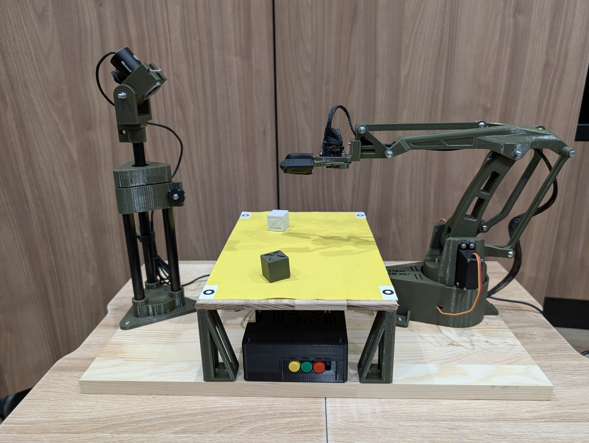
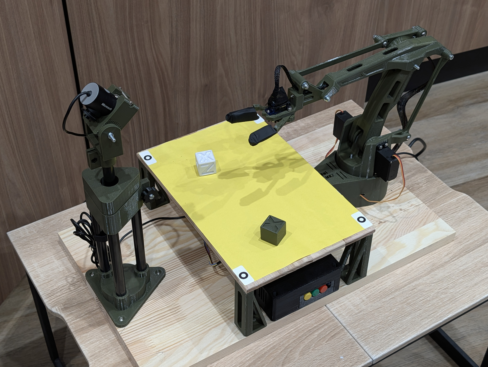
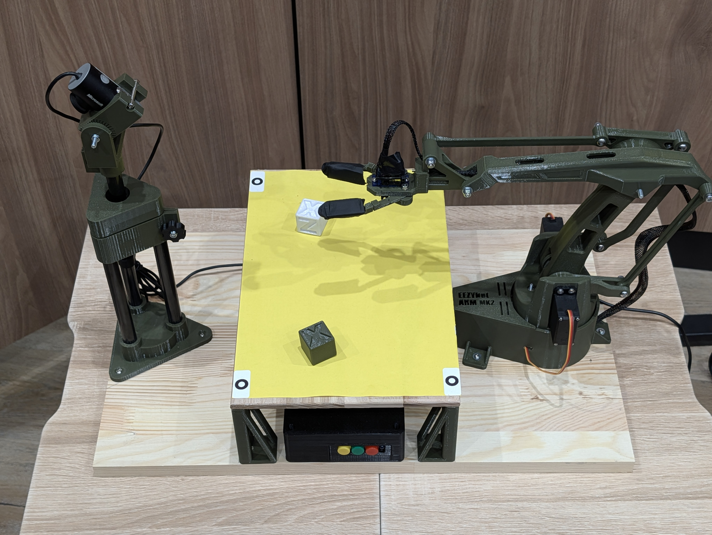
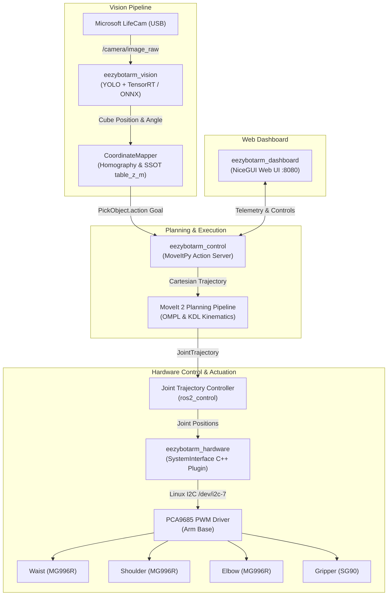

# EezyBotArm ROS 2 Jazzy & MoveIt 2 Autonomous Robotic Cell

[](https://docs.ros.org/en/jazzy/)
[](https://moveit.picknik.ai/)
[](https://www.nvidia.com/en-us/autonomous-machines/embedded-systems/jetson-orin/)
[](https://developer.nvidia.com/tensorrt)
[](https://github.com/vitaliimos/eezybotarm_yocto)
[](LICENSE)

An end-to-end, autonomous robotics workcell built on the open-source **EEZYbotARM Mk2** platform. Powered by **ROS 2 Jazzy**, **MoveIt 2**, **MoveItPy**, custom **C++ `ros2_control` hardware interface** for PCA9685 over Linux I2C, real-time **YOLO object detection accelerated with NVIDIA TensorRT**, and a **custom embedded Linux OS built with Yocto**.

---

<p align="center">
  
</p>

---

## 📺 Demonstration Video

Watch the complete autonomous pick-and-place and cube sorting workflow in action:

<p align="center">
  <a href="https://www.youtube.com/watch?v=Q4S6Ta60eEE" target="_blank">
    
    <br>
    <b>▶️ Watch Video Demonstration on YouTube</b>
  </a>
</p>

---

## 📚 Project Documentation & Hardware Guides

Detailed guides for recreating and deploying the robot workcell:

| Guide | Description |
| :--- | :--- |
| 🛠️ **[Mechanical Assembly & 3D Printing Guide](docs/assembly.md)** | PETG print settings, Bill of Materials, modular quick-release table legs ([`docs/models/`](docs/models/)), fasteners, arm assembly, and camera stand setup. |
| ⚡ **[Hardware & Wiring Guide](docs/hardware.md)** | Electronics schematics, PCA9685 I2C connections, Jetson 40-pin header, power isolation, and control panel buttons. |
| 📐 **[Calibration & Workspace Guide](docs/calibration.md)** | Single Source of Truth (`environment.yaml`), homography coordinate mapping, marker stickers, and servo PWM calibration. |
| 🐧 **[Jetson Yocto Embedded Linux](https://github.com/vitaliimos/eezybotarm_yocto)** | Custom Yocto layer (`meta-eezybot`) deploying headless bootable ROS 2 Jazzy image for Jetson Orin Nano with auto-start systemd units. |

---

## 📸 Workcell Gallery

<p align="center">
  
  &nbsp;
  
</p>

---

## 🏗️ System Architecture



---

## 📦 Packages Overview

```text
├── docs/                       # Assembly, Hardware, and Calibration guides & images
├── scripts/                    # TensorRT engine build & inference verification tools
├── move.sh                     # Helper script to trigger PickObject action goal
├── docker-run.sh               # Dev container execution helper
└── src/
    ├── eezybotarm_description/ # URDF, Xacro kinematics, meshes, and environment.yaml SSOT
    ├── eezybotarm_hardware/    # C++ ros2_control hardware interface for PCA9685 over Linux I2C
    ├── eezybotarm_moveit_config/# MoveIt 2 SRDF, OMPL, controllers, and launch orchestrations
    ├── eezybotarm_control/     # High-level MoveItPy Pick-and-Place action server
    ├── eezybotarm_vision/      # YOLO object detector with TensorRT & homography coordinate mapping
    ├── eezybotarm_dashboard/   # NiceGUI-based interactive web dashboard (port 8080)
    ├── eezybotarm_debug/       # Diagnostic tools and visualization helpers
    └── eezybotarm_interfaces/  # Custom action definitions (PickObject.action)
```

- **`eezybotarm_description`**: URDF models, 3D meshes, and workspace single-source-of-truth geometry (`environment.yaml`).
- **`eezybotarm_hardware`**: High-performance C++ `hardware_interface::SystemInterface` communicating directly with PCA9685 over `/dev/i2c-*` without Arduino or external bridges.
- **`eezybotarm_moveit_config`**: Kinematics configuration, SRDF semantic descriptions, OMPL planner setup, and launch files (`local.launch.py` and `jetson.launch.py`).
- **`eezybotarm_control`**: Clean Python 3 action server implementing cartesian motion planning, approach, grasp, retreat, and place trajectories using `moveit_py`.
- **`eezybotarm_vision`**: Detects cubes, estimates 2D grasp orientations, and maps camera pixel coordinates to real-world robot poses.
- **`eezybotarm_dashboard`**: Real-time web UI showing camera stream, action state, and manual triggers.

---

## 🚀 Getting Started

### Option 1: Using VS Code Dev Container (Recommended)

The repository provides a complete, pre-configured development environment using Docker and Dev Containers:

1. Install [Docker](https://docs.docker.com/get-docker/) and [Visual Studio Code](https://code.visualstudio.com/).
2. Install the **Dev Containers** extension in VS Code.
3. Open this repository folder in VS Code.
4. When prompted, click **"Reopen in Container"** (or press `Ctrl+Shift+P` / `Cmd+Shift+P` and select `Dev Containers: Reopen in Container`).
5. All system libraries, ROS 2 Jazzy packages, MoveIt 2, and compilers will be installed automatically.

### Option 2: Native Local Setup (Ubuntu 24.04 + ROS 2 Jazzy)

If developing natively on Ubuntu 24.04 with ROS 2 Jazzy:

1. **Install ROS 2 Jazzy Base & Development Tools**:
   ```bash
   sudo apt update
   sudo apt install -y python3-colcon-common-extensions python3-rosdep python3-vcstool
   ```

2. **Initialize rosdep and register local project rules**:
   ```bash
   test -f /etc/ros/rosdep/sources.list.d/20-default.list || sudo rosdep init
   echo "yaml file://$(pwd)/rosdep.yaml" | sudo tee /etc/ros/rosdep/sources.list.d/50-eeazybot.list
   rosdep update
   ```

3. **Install Package Dependencies**:
   ```bash
   PIP_BREAK_SYSTEM_PACKAGES=1 rosdep install --from-paths src --ignore-src -r -y
   ```

4. **Hardware Access Setup (for physical I2C)**:
   ```bash
   sudo apt install -y i2c-tools libi2c-dev
   sudo usermod -aG i2c $USER
   ```
   *(Log out and back in for group changes to take effect).*

---

## 🔨 Building the Workspace

Build all packages using `colcon`:

```bash
colcon build --symlink-install --cmake-args -DCMAKE_EXPORT_COMPILE_COMMANDS=ON
```

After the build completes, source the workspace overlay:

```bash
source install/setup.bash
```

---

## 🤖 Running the Robot

### 1. Local Development & Simulation (`local.launch.py`)

Run this mode for local development and testing without physical hardware. It launches mock joint hardware, mock camera, MoveIt 2 planning pipelines, the pick-and-place action server, the vision sorting node (ONNX model), RViz GUI, and the NiceGUI web dashboard (port `8080`):

```bash
./docker-run.sh ros2 launch eezybotarm_moveit_config local.launch.py
```

Available launch arguments:
* `use_mock_hardware` (default: `true`): Use mock hardware interfaces.
* `camera` (default: `mock`): Camera streaming mode (`mock`, `real`, `none`).
* `use_rviz` (default: `true`): Launch RViz for visualization and planning.
* `use_dashboard` (default: `true`): Launch the NiceGUI web dashboard on port `8080`.
* `weights_path` (default: `<eezybotarm_vision>/models/model.onnx`): Path to YOLO weights file.

### 2. Target Hardware on NVIDIA Jetson (`jetson.launch.py`)

Run this mode on the physical robot (automatically managed as a systemd service `eezybotarm.service` when deployed via Yocto). It runs headless with the physical `ros2_control` PCA9685 I2C driver and USB camera:

```bash
ros2 launch eezybotarm_moveit_config jetson.launch.py profile:=prod
```

Available launch arguments:
* `profile` (default: `prod`, choices: `prod`, `dev`): Selects TensorRT engine (`/usr/share/models/model.engine`) for `prod` or ONNX (`/usr/share/models/model.onnx`) for `dev`.
* `i2c_bus` (default: `/dev/i2c-7`): Path to the Linux I2C device on Jetson Orin Nano.
* `i2c_address` (default: `0x60`): I2C hex address of the PCA9685 driver board.
* `pwm_frequency` (default: `50`): Servo PWM frequency in Hz.
* `weights_path` (default: determined by `profile`): Explicit override for YOLO model path.

---

## 🧪 Testing Motion with the Action Client

Once the stack is running, trigger an autonomous pick-and-place sequence using the helper script:

```bash
./move.sh
```

Or invoke the action directly via the ROS 2 CLI:

```bash
ros2 action send_goal /pick_and_place eezybotarm_interfaces/action/PickObject \
  "{object_class: 'white_cube', target_pose: {header: {frame_id: 'base_link'}, pose: {position: {x: 0.22, y: 0.0, z: 0.1025}, orientation: {w: 1.0}}}}" \
  --feedback
```

---

## 🧠 Computer Vision & TensorRT Acceleration

The `eezybotarm_vision` package detects sorting cubes and estimates their 2D orientation angles using YOLO accelerated with **NVIDIA TensorRT**.

### 1. Generating the TensorRT Engine on PC

TensorRT `.engine` plans are GPU architecture-specific and must be built on the target hardware from `src/eezybotarm_vision/models/model.onnx`:

#### Method A: Using the Python Helper Script
```bash
python3 scripts/build_trt_engine.py \
    --onnx src/eezybotarm_vision/models/model.onnx \
    --output src/eezybotarm_vision/models/model.engine \
    --fp16
```

#### Method B: Using `trtexec` CLI
```bash
trtexec --onnx=src/eezybotarm_vision/models/model.onnx \
        --saveEngine=src/eezybotarm_vision/models/model.engine \
        --minShapes=images:1x3x640x640 \
        --optShapes=images:1x3x640x640 \
        --maxShapes=images:1x3x640x640 \
        --fp16
```

### 2. Testing Inference on PC
```bash
# Test inference and save annotated image to /tmp/yolo_test_result.jpg
./docker-run.sh python3 scripts/test_yolo_inference.py --weights src/eezybotarm_vision/models/model.engine
```

---

## 📄 License & Attribution

- **Source Code**: Licensed under the [MIT License](LICENSE).
- **3D Model Meshes**: The STL mesh models in `src/eezybotarm_description/meshes/` are based on the **EEZYbotARM Mk2** open-source project by Carlo Franciscone (daGHIZmo) and are licensed under [Creative Commons Attribution - Non-Commercial 3.0 Unported (CC BY-NC 3.0)](https://creativecommons.org/licenses/by-nc/3.0/).
  - [Instructables Project](https://www.instructables.com/EEZYbotARM-Mk2-3D-Printed-Robot/)
  - [Thingiverse (thing:1454048)](https://www.thingiverse.com/thing:1454048)
  - [Onshape CAD Model](https://cad.onshape.com/documents/eb6eac15e3f68718c52d3cac/w/2b8e59d1698d09b06440ab07/e/c11caf264884cee4298c28f7)
- **Modular Table Legs**: Custom modular table legs with quick-release magnet slots in [`docs/models/`](docs/models/), CAD source on [OnShape](https://cad.onshape.com/documents/16d39f2070b44c63ae6d65e0/w/bce775a624cd334bceeabdce/e/fb3a7e57508b0b67b010a788).
