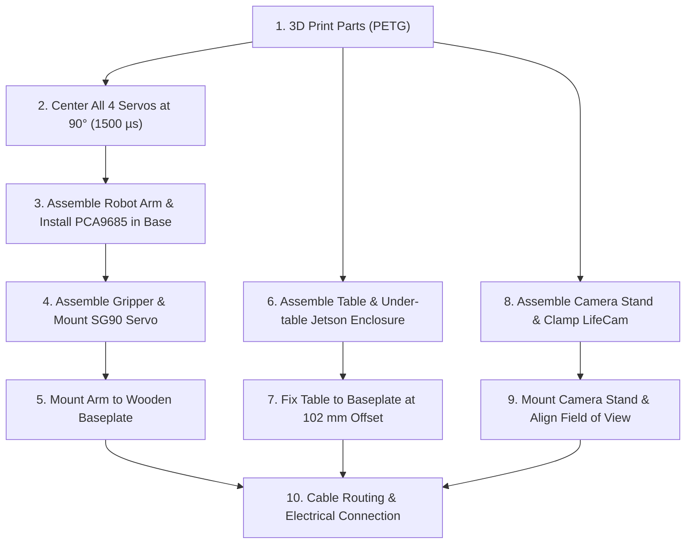

# Mechanical Assembly & 3D Printing Guide

This guide details the physical assembly, 3D printing parameters, and mechanical construction of the **EezyBotArm** robotic cell.

---

## Workspace Layout & Physical Setup

The entire workcell is rigidly mounted to a wooden baseplate. This guarantees a fixed coordinate frame between the robot base, the sorting table, and the camera mount:

### Physical Layout Elements
1. **Wooden Baseplate**: A flat timber board ($500\text{ mm} \times 300\text{ mm} \times 18\text{ mm}$) providing rigid anchoring for the robot base, table legs, and camera tripod.
2. **Elevated Sorting Table**:
   - Board dimensions: $300\text{ mm} \times 200\text{ mm} \times 9\text{ mm}$ ($X \times Y \times Z$).
   - Table height: $90\text{ mm}$ above the baseplate (`table_z_m: 0.09` in `environment.yaml`). The modular legs are designed specifically for a $9\text{ mm}$ board; if a board of different thickness is used, `table_z_m` must be updated.
   - Distance from arm base: $102\text{ mm}$ along the X-axis from robot base center (`robot_x_offset_m: 0.102`).
   - Covered with a high-contrast yellow surface and 4 corner marker stickers ($30\text{ mm} \times 15\text{ mm}$).
   > [!NOTE]
   > Dimensions are customizable. If using different board sizes, adjust `table_depth_m`, `table_width_m`, `robot_x_offset_m`, and `table_z_m` in [`src/eezybotarm_description/config/environment.yaml`](../src/eezybotarm_description/config/environment.yaml).
3. **Jetson Under-Table Enclosure**: Placed cleanly beneath the table between the legs, resting freely on the baseplate with front-facing controls and accessible I/O ports.
4. **Camera Stand**: Adjustable dual-rod stand holding the Microsoft LifeCam tilted downward toward the table center.

---

## 3D Printing Guidelines

All printed components are manufactured using **PETG** filament for superior tensile strength, layer adhesion, and resistance to creep under mechanical load.

| Component Group | Recommended Material | Walls / Perimeters | Infill Density | Notes |
| :--- | :--- | :--- | :--- | :--- |
| **Robotic Arm Links & Base** | **PETG** | 4–5 walls | 25%–30% (Gyroid) | Maximum rigidity prevents arm flexing during rapid acceleration. |
| **Arm Base Nut Cap (`m6_cap.stl`)** | **PETG** or PLA | 3–4 walls | 20% | Friction-fit insulating cap over base M6 nut to protect PCA9685 from short circuits. |
| **Gripper Jaws & Gears** | **PETG** | 4 walls | 30% | High mechanical wear area. |
| **Table Legs & Brackets** | **PETG** or PLA | 3–4 walls | 20% | Two-part quick-release design (`table_leg_base.stl` & `table_leg_connector.stl`). Scale connectors to ~100.5% if magnets are omitted. |
| **Jetson Enclosure (`jetson_base.stl`, `jetson_lid.stl`)** | **PETG** or PLA | 3 walls | 20% | Dimensionally accurate cutouts for ports, 2x M3 heat-set inserts, 2x snap-fits, and 3x 12mm button cutouts. |
| **Camera Stand & Clamps** | **PETG** or PLA | 4 walls | 25% | Rigid clamping on guide rods to prevent camera vibration. |

### Source 3D Models
- **Robot Arm & Gripper**: Open-source [EEZYbotARM Mk2 by daGHIZmo (Thingiverse: 1454048)](https://www.thingiverse.com/thing:1454048).
- **Modular Table Legs**: STL files in [`docs/models/`](models/) ([`table_leg_base.stl`](models/table_leg_base.stl) and [`table_leg_connector.stl`](models/table_leg_connector.stl)); parametric CAD on [OnShape](https://cad.onshape.com/documents/16d39f2070b44c63ae6d65e0/w/bce775a624cd334bceeabdce/e/fb3a7e57508b0b67b010a788).
- **Jetson Orin Nano Enclosure**: Custom two-piece enclosure ([`jetson_base.stl`](models/jetson_base.stl) and [`jetson_lid.stl`](models/jetson_lid.stl)).
- **Arm Base Protective Cap**: Custom M6 nut isolation shroud ([`m6_cap.stl`](models/m6_cap.stl)).

---

## Fasteners & Mechanical Hardware

- **Bearings**: Standard 608ZZ or miniature radial ball bearings (per Mk2 BOM for joint pivots).
- **Screws & Fasteners**:
  - M6 central bolt / threaded rod and M6 hex locknut for anchoring the robot arm base to the bottom wooden baseplate.
  - 2x M3 brass heat-set threaded inserts ($M3 \times 5\text{ mm}$, outer diameter $\varnothing 4.2\text{ mm}$) melted into the Jetson base mounting posts.
  - 2x M3 machine screws ($M3 \times 8\text{ mm}$) for securing the Jetson enclosure lid into the heat-set inserts.
  - M4 bolts (various lengths: 20mm, 30mm, 40mm) and M4 nylon-insert locknuts for primary arm joints.
  - M3 machine screws for servo motor mounting and gripper linkage.
  - $1.5 \times 6\text{ mm}$ self-tapping screws for securing the table legs to the table board and baseplate (adjust screw length if using different board thicknesses).
  - Wood screws for securing robot base and camera stand to the wooden baseplate.
- **Pushbuttons**:
  - 3x $12\text{ mm}$ momentary pushbuttons (Red: Power, Green: Force Recovery, Yellow: Reset) mounted in the Jetson enclosure lid.
- **Structural Guide Tubes**:
  - 2x steel tubes (repurposed from JYSK BORNHOLM shoe rack) serving as the vertical guide rails for the camera stand.
- **Magnets (Optional)**:
  - $\varnothing 2\text{ mm} \times 1.5\text{ mm}$ cylindrical neodymium magnets (2 per base socket, 2 per connector insert; 16 total across 4 legs) for tool-free quick-release table mounting.
- **Foam / Rubber Gripper Pads**: Soft silicone or neoprene pads applied to gripper finger tips for positive friction when grasping 3D-printed cubes.

---

## Step-by-Step Assembly Instructions

### 1. Zeroing / Centering the Servos (CRITICAL)

> [!CAUTION]
> Before attaching any servo horns or mechanical linkages, connect each servo to a servo tester or PCA9685 signal generator at **neutral (1500 µs pulse width / 0 rad position)**. Installing horns onto uncentered servos will limit travel range and cause mechanical binding or servo stall.

1. Connect the 3x MG996R and 1x SG90 servos.
2. Command them to their midpoint:
   - Waist: $0^\circ$ (pointing directly forward toward $+X$).
   - Shoulder: $90^\circ$ neutral.
   - Elbow: $90^\circ$ neutral.
   - Gripper: Mid-travel.
3. Affix the servo horns at the neutral orientation before bolting down the arm linkages.

---

### 2. Arm Mechanical Assembly

1. **Base & Waist Joint**:
   - Bolt the base assembly to the wooden baseplate using the central M6 bolt and tighten the M6 locknut inside the base cavity.
   - Press the 3D-printed protective cap ([`m6_cap.stl`](models/m6_cap.stl)) firmly over the M6 nut and protruding thread. This insulates the bare metal hardware and prevents electrical shorts or mechanical abrasion against the PCA9685 board.
   - Install the main base bearing.
   - Mount the waist MG996R servo inside the lower chassis.
   - Wire the PCA9685 board and place it safely inside the insulated cavity in the arm base.
2. **Main Arm Links**:
   - Assemble the vertical shoulder link using M4 bolts and locknuts. Ensure joints rotate smoothly without excessive play or binding.
   - Attach the elbow linkage rod ensuring the parallel kinematic geometry moves freely.
3. **Gripper Assembly**:
   - Fasten the SG90 micro-servo to the wrist bracket.
   - Align the parallel gripper gears and install the finger linkages.
   - Apply silicone rubber / tape to the inner faces of the finger grippers for friction.

---

### 3. Table & Enclosure Mounting

1. **Modular Table Construction**:
   - Cut a wooden table board to $300\text{ mm} \times 200\text{ mm} \times 9\text{ mm}$ (and prepare the baseplate at $500\text{ mm} \times 300\text{ mm} \times 18\text{ mm}$).
   - **Leg Sockets (`table_leg_base.stl`)**: Fasten the 4 base sockets to the baseplate using $1.5 \times 6\text{ mm}$ self-tapping screws at the target position ($102\text{ mm}$ offset from robot base center along $+X$).
   - **Leg Inserts (`table_leg_connector.stl`)**: Fasten the 4 connector inserts to the underside corners of the $9\text{ mm}$ table board using $1.5 \times 6\text{ mm}$ screws.
   - **Retention**:
     - *With magnets*: Press-fit and glue two $\varnothing 2\text{ mm} \times 1.5\text{ mm}$ neodymium magnets into each socket and connector (ensure matching attraction polarities). This locks the table solidly while allowing tool-free removal.
     - *Without magnets*: Print connectors scaled at ~100.5% for a snug friction fit directly into the base sockets.
   - Verify that the table top surface sits at exactly $90\text{ mm}$ ($0.09\text{ m}$) above the baseplate (`table_z_m: 0.09` in `environment.yaml`).
   - Affix the matte yellow table paper/vinyl.
   - Place the 4 corner alignment stickers flush with each corner ($30\text{ mm} \times 15\text{ mm}$).
2. **Jetson Enclosure**:
   - Using a soldering iron, melt two M3 brass threaded inserts ($M3 \times 5\text{ mm}$, $\varnothing 4.2\text{ mm}$) into the dedicated mounting posts of the enclosure base ([`jetson_base.stl`](models/jetson_base.stl)).
   - Seat the Jetson Orin Nano Developer Kit inside `jetson_base.stl`.
   - Install the three $12\text{ mm}$ momentary pushbuttons (🔴 Red: Power, 🟢 Green: Force Recovery, 🟡 Yellow: Reset) into the front panel of the lid ([`jetson_lid.stl`](models/jetson_lid.stl)) and wire them to the Jetson button header pins (J14).
   - Mate the lid to the base: engage the 2 snap-fit clips and fasten the front with 2x M3 machine screws into the heat-set inserts.
   - Place the assembled enclosure under the sorting table between the legs, resting freely on the wooden baseplate.

---

### 4. Camera Stand Assembly & Framing

1. Assemble the camera stand base and insert the dual vertical guide tubes.
2. Clamp the adjustable slider bracket at a height that allows the camera to see the full $300\text{ mm} \times 200\text{ mm}$ table surface and all 4 corner stickers.
3. Tilt the Microsoft LifeCam so that the camera's optical axis looks downward at an angle of roughly $45^\circ$ toward the table center.
4. Fasten the stand base to the wooden board.

---

### 5. Cable Management

- Route the servo wires through the arm's braided protective sleeving to the PCA9685 board in the base.
- Run the 4-wire I2C cable from the Jetson enclosure under the table to the PCA9685 in the arm base.
- Connect the USB camera cable directly to one of the Jetson USB 3.0 ports.
- Ensure cables do not catch or pull tight during full $\pm 90^\circ$ rotation of the arm waist.
