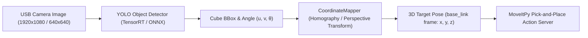

# Calibration & Workspace Configuration Guide

This guide explains how to calibrate the **EezyBotArm** workspace, servo parameters, and camera coordinate transformation.

---

## 1. Single Source of Truth (SSOT): `environment.yaml`

To eliminate magic numbers across URDF, MoveIt 2 collision matrices, camera vision nodes, and action servers, all physical workspace dimensions reside strictly in:

[`src/eezybotarm_description/config/environment.yaml`](../src/eezybotarm_description/config/environment.yaml)

```yaml
/**:
  ros__parameters:
    # Table geometry and workspace
    table_z_m: 0.09             # Height of the table surface above the baseboard
    table_depth_m: 0.200        # Table depth (along Y / X depending on frame)
    table_width_m: 0.300        # Table width along the front edge
    robot_x_offset_m: 0.102     # Distance from robot base center to table edge along X
    robot_y_offset_m: 0.0       # Table offset along Y (centered at 0.0)
    cube_height_m: 0.025        # 25 mm sorting cube height
    # Corner sticker dimensions (flush with table corners)
    sticker_width_m: 0.030      # 30 mm
    sticker_height_m: 0.015     # 15 mm
```

### Architectural Enforcement
- **URDF / MoveIt**: Loaded dynamically into [`src/eezybotarm_description/urdf/environment.xacro`](../src/eezybotarm_description/urdf/environment.xacro) using `xacro.load_yaml()`.
- **ROS 2 Nodes**: Passed directly as node parameters in launch files (`parameters=[..., environment_config]`). Nodes declare parameters without default fallbacks, raising `ParameterUninitializedException` if missing.
- **Table Surface = Workspace**: There are no separate "paper" or "virtual" coordinate offsets; the physical table surface defines the reference plane.

### Customizing Physical Workspace Dimensions
If using custom dimensions for table or cubes, modify `environment.yaml`:
| Parameter | Default | Physical Dimension & Adjustment Guidance |
| :--- | :--- | :--- |
| `table_depth_m` | `0.200` ($200\text{ mm}$) | Depth of the active sorting table board along the Y axis. |
| `table_width_m` | `0.300` ($300\text{ mm}$) | Width of the active sorting table board along the X axis. |
| `robot_x_offset_m` | `0.102` ($102\text{ mm}$) | Distance from the robot `base_link` center to the front edge of the table board. |
| `table_z_m` | `0.09` ($90\text{ mm}$) | Height of the table surface above the baseplate. The modular 3D-printed legs are calibrated for a **9 mm thick table board**. If a different board thickness or leg height is used, adjust `table_z_m` (in meters). |
| `cube_height_m` | `0.025` ($25\text{ mm}$) | Height of the sorting cubes ($25\text{ mm}$ default). Adjust if using cubes of different dimensions so that pick Z-height is calculated accurately. |

---

## 2. Servo Actuation Calibration (`ros2_control`)

Servo parameters are configured in [`src/eezybotarm_moveit_config/config/eezybotarm.ros2_control.xacro`](../src/eezybotarm_moveit_config/config/eezybotarm.ros2_control.xacro).

### The Golden Rule of Servo Calibration

> [!IMPORTANT]
> `rad_min` and `rad_max` define the **physical actuator calibration scale** corresponding to the PWM pulse limits `us_min` and `us_max`.
>
> For $180^\circ$ analog/digital servos (MG996R, SG90):
> $$\text{Pulse range: } 600\ \mu\text{s} \text{ to } 2400\ \mu\text{s} \implies \text{Physical angle: } -\frac{\pi}{2} \text{ to } +\frac{\pi}{2}\ (-1.5708\text{ to } +1.5708\text{ rad})$$
>
> **NEVER use `rad_min` and `rad_max` to constrain joint travel limits!**
> Doing so compresses the PWM scale, distorts movement velocity by up to 2.6×, and causes servo buzzing, stalling, and overheating.
>
> **Soft joint travel limits** must be defined exclusively in `robot.urdf` and `joint_limits.yaml`.

### Joint Configurations

```xml
<!-- Waist Joint (Rotates the arm base) -->
<joint name="waist_joint">
    <param name="pca_channel">0</param>
    <param name="rad_min">-1.5708</param>
    <param name="rad_max">1.5708</param>
    <param name="us_min">600</param>
    <param name="us_max">2400</param>
    <param name="gear_ratio">2.0</param>
    <param name="invert_direction">true</param>
</joint>

<!-- Shoulder Joint (Elevates primary link) -->
<joint name="shoulder_joint">
    <param name="pca_channel">1</param>
    <param name="rad_min">-1.5708</param>
    <param name="rad_max">1.5708</param>
    <param name="us_min">600</param>
    <param name="us_max">2400</param>
</joint>

<!-- Elbow Joint (Forearm elevation via parallel linkage) -->
<joint name="elbow_joint">
    <param name="pca_channel">2</param>
    <param name="rad_min">-1.5708</param>
    <param name="rad_max">1.5708</param>
    <param name="us_min">600</param>
    <param name="us_max">2400</param>
    <param name="invert_direction">true</param>
</joint>

<!-- Parallel Gripper -->
<joint name="finger_left_joint">
    <param name="pca_channel">3</param>
    <param name="rad_min">-1.5708</param>
    <param name="rad_max">1.5708</param>
    <param name="us_min">600</param>
    <param name="us_max">2400</param>
</joint>
```

---

## 3. Computer Vision & Coordinate Mapping



### 1. Vision Detection
- The `eezybotarm_vision` node runs YOLO-OBB inference (accelerated via TensorRT `.engine` on Jetson, or ONNX Runtime on local dev PC).
- The model is trained on **two target classes**:
  - `white_cube`: Standard white cube ($25\text{ mm}$).
  - `green_cube`: Khaki / olive green cube ($25\text{ mm}$) — designated internally as `green_cube` across the YOLO model, dataset labels, and sorting coordinator.
- It detects cube oriented bounding boxes (OBB) and calculates bounding box centers $(u, v)$ and 2D orientation angles $\theta$.

### 2. Coordinate Transformation to Robot Frame
1. **Corner Markers**: 4 high-contrast markers placed at the known corners of the table allow perspective correction and camera intrinsic/extrinsic mapping.
2. **Table to Base Transform**:
   Using `robot_x_offset_m` ($102\text{ mm}$) and `table_z_m` ($90\text{ mm}$), points on the table surface are mapped to the robot's `base_link` frame:
   $$X_{\text{robot}} = X_{\text{table}} + \text{robot\_x\_offset\_m}$$
   $$Y_{\text{robot}} = Y_{\text{table}} + \text{robot\_y\_offset\_m}$$
   $$Z_{\text{robot}} = \text{table\_z\_m} + \frac{\text{cube\_height\_m}}{2}$$

---

## 4. Verification & Testing

### Test Vision Pipeline
```bash
# In simulation / PC mode with mock camera:
./docker-run.sh ros2 launch eezybotarm_vision vision.launch.py camera:=mock gui:=true
```

### Test Pick-and-Place Action
```bash
# Send test pick goal at specified coordinates
ros2 action send_goal /pick_and_place eezybotarm_interfaces/action/PickObject \
  "{object_class: 'white_cube', target_pose: {header: {frame_id: 'base_link'}, pose: {position: {x: 0.22, y: 0.0, z: 0.1025}, orientation: {w: 1.0}}}}" \
  --feedback
```
Or execute the helper script:
```bash
./move.sh
```
