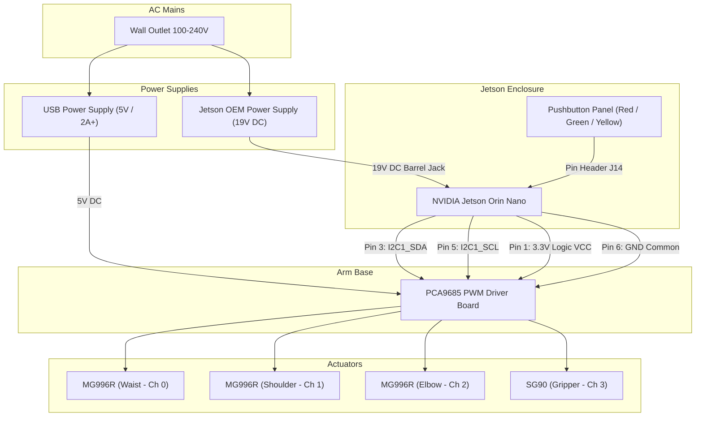

# Hardware & Electronics Guide

This document describes the electrical architecture, Bill of Materials (BOM), pinouts, and wiring connections for the **EezyBotArm** robotic pick-and-place cell.

---

## Bill of Materials (BOM)

### 1. Compute & Vision
| Component | Model / Spec | Qty | Role / Notes |
| :--- | :--- | :--- | :--- |
| **SBC** | NVIDIA Jetson Orin Nano Developer Kit (8GB) | 1 | Runs custom embedded Linux (Yocto), ROS 2 Jazzy, TensorRT YOLO inference, and MoveIt 2. |
| **Camera** | Microsoft LifeCam Studio (Q2F-00015) | 1 | USB 2.0 720p/1080p camera mounted on adjustable stand facing table. |
| **Camera Stand Tubes** | Steel tubes from [JYSK Shoe rack BORNHOLM 1 shelf](https://jysk.ua/zberigannya/polici-ta-shafi-dlya-vzuttya/polytsya-dlya-vzuttya-bornholm-1pol-chornyy?nis=8) | 4 | Vertical guide tubes for the camera riser stand. |
| **Enclosure** | 3D Printed Custom Enclosure ([`jetson_base.stl`](models/jetson_base.stl), [`jetson_lid.stl`](models/jetson_lid.stl)) | 1 | Houses the Jetson developer kit under the sorting table. Features 2x snap-fits and 2x M3 brass heat-set inserts ($M3 \times 5\text{ mm}$, $\varnothing 4.2\text{ mm}$) with M3 screws. |
| **Control Buttons** | 12mm Momentary Pushbuttons (Red, Green, Yellow) | 3 | Mounted on the enclosure lid front panel and connected to Jetson Button Header J14 (Power, Force Recovery, Reset). |

### 2. Actuation & Servo Driver
| Component | Model / Spec | Qty | Role / Notes |
| :--- | :--- | :--- | :--- |
| **PWM Driver** | PCA9685 16-Channel 12-bit PWM Board | 1 | Driven via I2C (`/dev/i2c-7` on Jetson, address `0x60`, 50 Hz). Located inside arm base cavity. |
| **Nut Isolation Cap** | 3D Printed Protective Cap ([`m6_cap.stl`](models/m6_cap.stl)) | 1 | Non-conductive cap press-fit over the M6 base mounting nut to prevent shorts and protect the PCA9685 board. |
| **Base / Waist Servo** | MG996R (Metal Gear, 180°) | 1 | Channel 0. Joint `waist_joint` (2:1 gear ratio, inverted direction). |
| **Shoulder Servo** | MG996R (Metal Gear, 180°) | 1 | Channel 1. Joint `shoulder_joint`. |
| **Elbow Servo** | MG996R (Metal Gear, 180°) | 1 | Channel 2. Joint `elbow_joint` (inverted direction). |
| **Gripper Servo** | SG90 / MG90S Micro Servo (180°) | 1 | Channel 3. Joint `finger_left_joint` (parallel jaw gripper). |

### 3. Power Supplies & Cabling
| Component | Spec | Qty | Role / Notes |
| :--- | :--- | :--- | :--- |
| **Jetson Power Adapter** | 19V DC (or 9V–20V OEM power supply) | 1 | Supplies main compute power to Jetson Orin Nano barrel jack. |
| **Servo Power Adapter** | 5V / 2A+ USB Power Adapter | 1 | Supplies `V+` screw terminal on PCA9685 to power all 4 servos independently. |
| **Cabling** | 4-wire ribbon / Jumper wires (I2C + GND + VCC) | 1 | Connects Jetson 40-pin header to PCA9685 inside arm base. |
| **Cable Sleeving** | Braided wire sleeve | - | Tidies servo and camera wiring harness. |

---

## Power Distribution & Common Ground

> [!IMPORTANT]
> **Never power servos directly from the Jetson 5V pins!** Standard servos (like MG996R) draw high stall currents (up to 1.5A–2.5A each) and introduce inductive voltage spikes that will reset or damage the Jetson.

---

## Wiring & Pinouts

### 1. Jetson Orin Nano 40-Pin Header to PCA9685

The hardware interface (`src/eezybotarm_hardware`) communicates over Linux I2C (`/dev/i2c-7` on Jetson Orin Nano) at address `0x60`.

| Jetson 40-Pin Header Pin | Signal Name | PCA9685 Pin | Description |
| :--- | :--- | :--- | :--- |
| **Pin 1** | 3.3V Power | **VCC** | Logic power for PCA9685 chip |
| **Pin 3** | I2C1_SDA (Bus 7) | **SDA** | I2C Data line |
| **Pin 5** | I2C1_SCL (Bus 7) | **SCL** | I2C Clock line |
| **Pin 6 (or 9, 14, 20)** | GND | **GND** | Logic ground (MUST share common ground) |
| *External 5V supply (+)* | +5V (V+) | **V+ (Terminal Block)** | Dedicated servo motor power |
| *External 5V supply (-)* | GND | **GND (Terminal Block)** | Servo ground (connected to logic GND on board) |

> [!NOTE]
> On the NVIDIA Jetson Orin Nano, the physical I2C pins (Pins 3 and 5) map to device `/dev/i2c-7`. The default configuration in `src/eezybotarm_moveit_config/launch/jetson.launch.py` uses `i2c_bus:=/dev/i2c-7` and `i2c_address:=0x60`.

---

### 2. PCA9685 Servo Channels Configuration

The servo channels and calibration parameters are defined in `src/eezybotarm_moveit_config/config/eezybotarm.ros2_control.xacro`:

| Channel | Joint Name | Physical Servo | Calibration Scale | Limits / Notes |
| :---: | :--- | :--- | :--- | :--- |
| **0** | `waist_joint` | TowerPro MG996R | `rad_min`: -1.5708, `rad_max`: 1.5708 `us_min`: 600, `us_max`: 2400 | `gear_ratio`: 2.0 `invert_direction`: `true` |
| **1** | `shoulder_joint` | TowerPro MG996R | `rad_min`: -1.5708, `rad_max`: 1.5708 `us_min`: 600, `us_max`: 2400 | Direct drive arm |
| **2** | `elbow_joint` | TowerPro MG996R | `rad_min`: -1.5708, `rad_max`: 1.5708 `us_min`: 600, `us_max`: 2400 | Parallel linkage `invert_direction`: `true` |
| **3** | `finger_left_joint` | SG90 / MG90S | `rad_min`: -1.5708, `rad_max`: 1.5708 `us_min`: 600, `us_max`: 2400 | Parallel jaw gripper |

---

### 3. Jetson Front Panel Control Buttons

The 3 colored momentary pushbuttons ($\varnothing 12\text{ mm}$) mounted directly on the front panel of the Jetson enclosure lid ([`jetson_lid.stl`](models/jetson_lid.stl)) are connected to the Jetson Developer Kit Button Header (J14):

| Button Color | Function | Jetson Button Header Pin | Action Description |
| :--- | :--- | :--- | :--- |
| 🔴 **Red** | **Power / Sleep** | `PWR_BTN` (Pins 7 & 8) | Short to GND turns system ON, enters sleep, or initiates graceful shutdown. |
| 🟢 **Green** | **Force Recovery** | `FC_REC` (Pins 9 & 10) | Held down while powering on / resetting to enter NVIDIA Force Recovery Mode for flashing. |
| 🟡 **Yellow** | **Reset / Restart** | `SYS_RST` (Pins 5 & 6) | Short to GND immediately triggers a hard system reset. |
