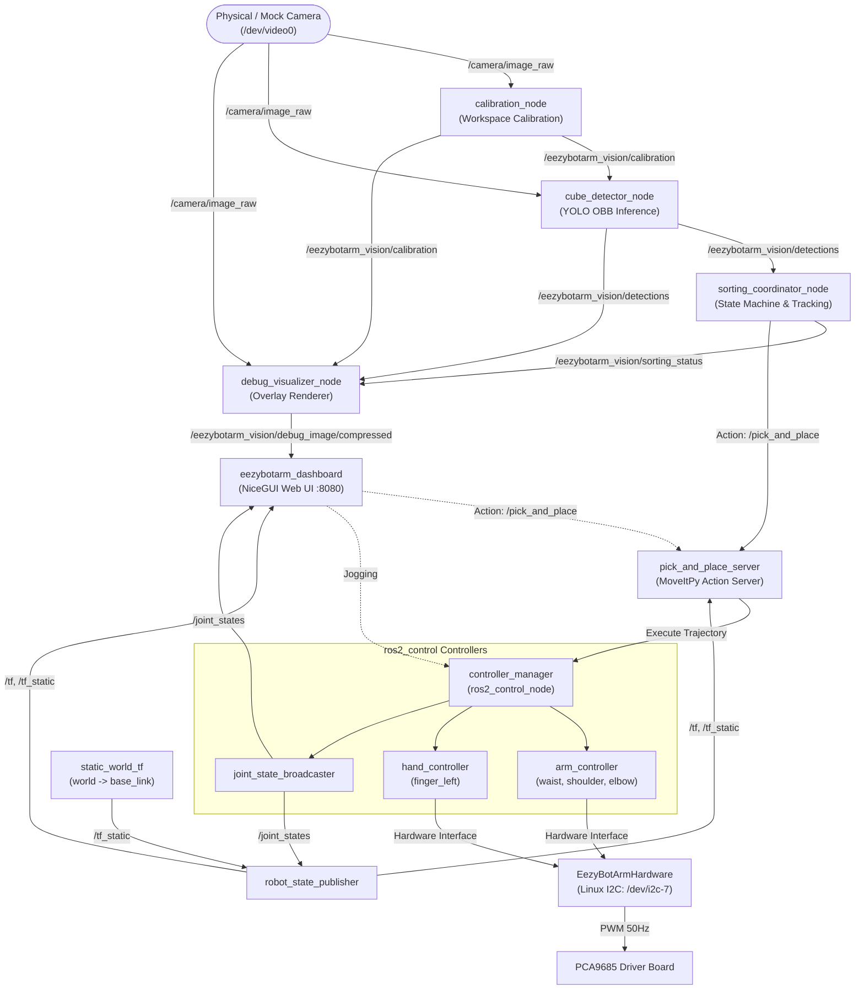
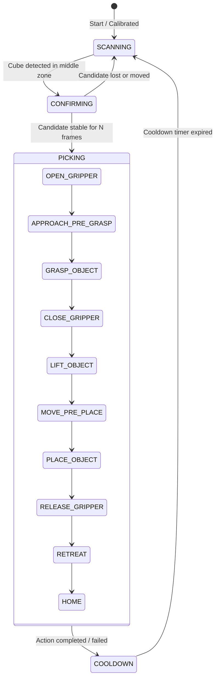

# ROS 2 Nodes & Computation Graph

This document describes the ROS 2 node architecture, inter-node communication, topics, actions, transforms, and dataflow in the **EezyBotArm** robotic workcell.

---

## 1. System Computation Graph

---

## 2. Node Reference Catalog

### Vision & Perception

#### `camera` / `mock_camera`
* **Package**: `v4l2_camera` / `image_publisher`
* **Role**: Captures raw frames from the USB camera (720p at 10 fps) or publishes mock test frames.
* **Publishes**:
  * `/camera/image_raw` (`sensor_msgs/msg/Image`)
  * `/camera/camera_info` (`sensor_msgs/msg/CameraInfo`)
* **Key Parameters**: `video_device` (`/dev/video0`), `image_size` (`[1280, 720]`).

#### `calibration_node`
* **Package**: `eezybotarm_vision`
* **Role**: Detects the 4 corner alignment markers on the table and computes a perspective homography matrix mapping image pixels to table millimeters.
* **Subscribes**:
  * `/camera/image_raw` (`sensor_msgs/msg/Image`)
* **Publishes**:
  * `/eezybotarm_vision/calibration` (`eezybotarm_interfaces/msg/WorkspaceCalibration`, Transient Local QoS)
* **Parameters**: `table_width_m`, `table_depth_m`, `sticker_width_m`, `sticker_height_m`, `recalibration_interval_sec`.

#### `cube_detector_node`
* **Package**: `eezybotarm_vision`
* **Role**: Runs YOLO-OBB inference (TensorRT `.engine` on Jetson or ONNX on PC), detects cubes, and maps coordinates into table millimeters and sorting zones.
* **Subscribes**:
  * `/camera/image_raw` (`sensor_msgs/msg/Image`)
  * `/eezybotarm_vision/calibration` (`eezybotarm_interfaces/msg/WorkspaceCalibration`)
* **Publishes**:
  * `/eezybotarm_vision/detections` (`eezybotarm_interfaces/msg/LocalizedCubeArray`)
* **Parameters**: `weights_path`, `conf_threshold`.

#### `debug_visualizer_node`
* **Package**: `eezybotarm_vision`
* **Role**: Renders visual overlays (table workspace boundaries, zones, bounding boxes, labels, and state banner) onto the camera stream only when active subscribers are connected.
* **Subscribes**:
  * `/camera/image_raw` (`sensor_msgs/msg/Image`)
  * `/eezybotarm_vision/calibration` (`eezybotarm_interfaces/msg/WorkspaceCalibration`)
  * `/eezybotarm_vision/detections` (`eezybotarm_interfaces/msg/LocalizedCubeArray`)
  * `/eezybotarm_vision/sorting_status` (`std_msgs/msg/String`)
* **Publishes**:
  * `/eezybotarm_vision/debug_image` (`sensor_msgs/msg/Image`)
  * `/eezybotarm_vision/debug_image/compressed` (`sensor_msgs/msg/CompressedImage`)
* **Parameters**: `debug_image_jpeg_quality`.

---

### Sorting & Motion Planning

#### `sorting_coordinator_node`
* **Package**: `eezybotarm_vision`
* **Role**: Coordinates sorting logic: tracks cube position stability over consecutive frames, converts table coordinates to `base_link` frame, assigns destination zones by class, and dispatches pick-and-place goals.
* **Subscribes**:
  * `/eezybotarm_vision/detections` (`eezybotarm_interfaces/msg/LocalizedCubeArray`)
* **Publishes**:
  * `/eezybotarm_vision/sorting_status` (`std_msgs/msg/String`, Transient Local QoS)
* **Action Client**:
  * `/pick_and_place` (`eezybotarm_interfaces/action/PickObject`)
* **Parameters**: `stable_frames_required`, `tracking_tolerance_mm`, `cooldown_duration_sec`, `action_name`, plus table geometry from `environment.yaml`.

#### `pick_and_place_action_server`
* **Package**: `eezybotarm_control` (executable: `pick_and_place_server`)
* **Role**: MoveItPy action server executing the pick-and-place state sequence: opens gripper, plans Cartesian approach, grasps cube, lifts, translates to destination, releases, and returns home.
* **Action Server**:
  * `/pick_and_place` (`eezybotarm_interfaces/action/PickObject`)
* **Trajectory Control**:
  * Submits planned trajectories directly to `arm_controller` and `hand_controller` via MoveItPy.
* **Parameters**: `approach_distance` (default `0.03 m`), MoveIt OMPL planning configurations.

---

### Hardware Control & Actuation

#### `controller_manager` (`ros2_control_node`)
* **Package**: `controller_manager`
* **Role**: Manages the hardware plugin lifecycle and trajectory controllers at 50 Hz.
* **Hardware Interface**:
  * `eezybotarm_hardware/EezyBotArmHardware` communicates over Linux I2C (`/dev/i2c-7`, address `0x60`) with the PCA9685 PWM driver.
* **Managed Controllers**:
  * `arm_controller`: `JointTrajectoryController` for `waist_joint`, `shoulder_joint`, `elbow_joint`.
  * `hand_controller`: `JointTrajectoryController` for `finger_left_joint`.
  * `joint_state_broadcaster`: Reads joint positions and publishes `/joint_states`.

#### `robot_state_publisher` & `static_world_tf`
* **Packages**: `robot_state_publisher`, `tf2_ros`
* **Role**: Publishes the complete kinematic tree TF frames (`world` $\to$ `base_link` $\to$ `waist_link` $\to$ `shoulder_link` $\to$ `elbow_link` $\to$ `ee_link`) based on URDF and `/joint_states`.

---

### Monitoring & Visualization

#### `eezybotarm_dashboard`
* **Package**: `eezybotarm_dashboard` (executable: `dashboard_node`)
* **Role**: Standalone NiceGUI web dashboard (default port `8080`) providing live camera feeds, joint telemetry, manual jogging controls, and dataset recording.
* **Subscribes**:
  * `/joint_states` (`sensor_msgs/msg/JointState`)
  * `/camera/image_raw/compressed` (`sensor_msgs/msg/CompressedImage`)
  * `/eezybotarm_vision/debug_image/compressed` (`sensor_msgs/msg/CompressedImage`)
  * TF listener (`base_link` $\to$ `ee_link`)
* **Publishes**:
  * `/arm_controller/joint_trajectory` (`trajectory_msgs/msg/JointTrajectory`)
  * `/hand_controller/joint_trajectory` (`trajectory_msgs/msg/JointTrajectory`)
* **Action Client**:
  * `/pick_and_place` (`eezybotarm_interfaces/action/PickObject`)

#### `workspace_visualizer`
* **Package**: `eezybotarm_debug`
* **Role**: Development utility calculating forward kinematics reachability on the table plane and publishing visualization markers to RViz.
* **Publishes**:
  * `/workspace_markers` (`visualization_msgs/msg/MarkerArray`, Transient Local QoS)

---

## 3. Communication Interfaces Summary

### Topics

| Topic | Type | Publisher | Subscriber(s) | QoS |
| :--- | :--- | :--- | :--- | :--- |
| `/camera/image_raw` | `sensor_msgs/Image` | `camera` / `mock_camera` | `calibration_node`, `cube_detector_node`, `debug_visualizer_node` | Volatile |
| `/camera/camera_info` | `sensor_msgs/CameraInfo` | `camera` | - | Volatile |
| `/eezybotarm_vision/calibration` | `eezybotarm_interfaces/WorkspaceCalibration` | `calibration_node` | `cube_detector_node`, `debug_visualizer_node` | Transient Local |
| `/eezybotarm_vision/detections` | `eezybotarm_interfaces/LocalizedCubeArray` | `cube_detector_node` | `sorting_coordinator_node`, `debug_visualizer_node` | Volatile |
| `/eezybotarm_vision/sorting_status` | `std_msgs/String` | `sorting_coordinator_node` | `debug_visualizer_node` | Transient Local |
| `/eezybotarm_vision/debug_image` | `sensor_msgs/Image` | `debug_visualizer_node` | `rqt_image_view` (optional) | Volatile |
| `/eezybotarm_vision/debug_image/compressed` | `sensor_msgs/CompressedImage` | `debug_visualizer_node` | `eezybotarm_dashboard` | Volatile |
| `/joint_states` | `sensor_msgs/JointState` | `joint_state_broadcaster` | `robot_state_publisher`, `eezybotarm_dashboard` | Volatile |
| `/tf`, `/tf_static` | `tf2_msgs/TFMessage` | `robot_state_publisher`, `static_world_tf` | `pick_and_place_server`, `eezybotarm_dashboard` | Volatile / Transient Local |
| `/arm_controller/joint_trajectory` | `trajectory_msgs/JointTrajectory` | `pick_and_place_server`, `eezybotarm_dashboard` | `arm_controller` | Volatile |
| `/hand_controller/joint_trajectory` | `trajectory_msgs/JointTrajectory` | `pick_and_place_server`, `eezybotarm_dashboard` | `hand_controller` | Volatile |
| `/workspace_markers` | `visualization_msgs/MarkerArray` | `workspace_visualizer` | RViz2 | Transient Local |

### Actions

| Action | Action Type | Server | Client(s) | Role |
| :--- | :--- | :--- | :--- | :--- |
| `/pick_and_place` | `eezybotarm_interfaces/action/PickObject` | `pick_and_place_server` | `sorting_coordinator_node`, `eezybotarm_dashboard` | Autonomous or manual pick-and-place execution |

---

## 4. Sorting Lifecycle & State Machine

---

## 5. Launch Entry Points

| Launch File | Command | Usage |
| :--- | :--- | :--- |
| **Jetson Target** | `ros2 launch eezybotarm_moveit_config jetson.launch.py` | Production on NVIDIA Jetson Orin Nano (V4L2 camera, TensorRT, real PCA9685 I2C). |
| **Local Dev** | `ros2 launch eezybotarm_moveit_config local.launch.py` | Full stack simulation on development PC (mock hardware, mock camera, RViz, Dashboard). |
| **Vision Standalone** | `ros2 launch eezybotarm_vision vision.launch.py camera:=mock gui:=true` | Standalone vision and sorting testing with sample image and GUI visualizer. |
| **Dashboard** | `ros2 launch eezybotarm_dashboard dashboard.launch.py` | Standalone NiceGUI web dashboard. |
